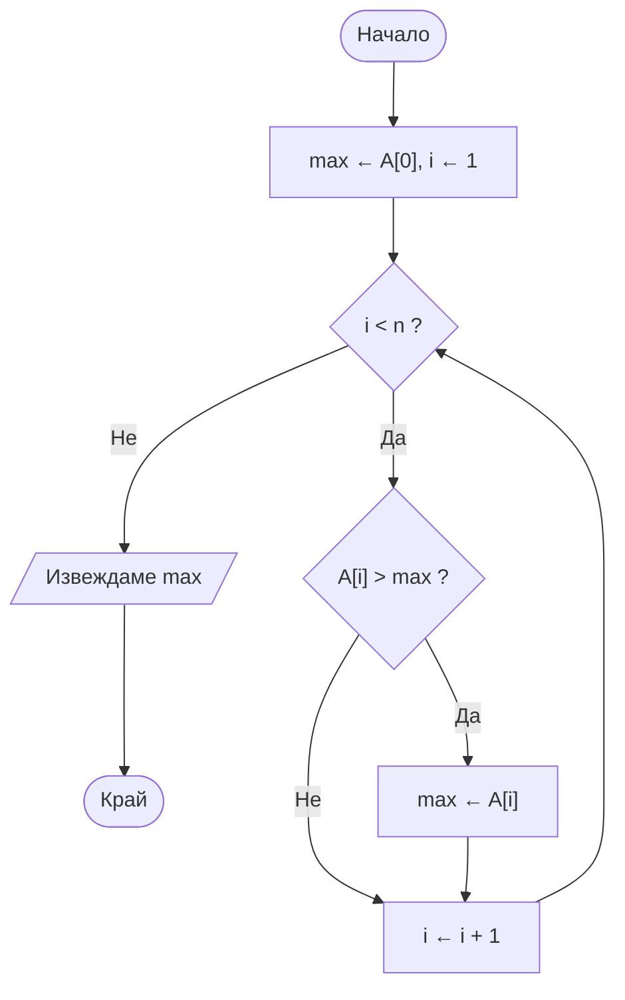
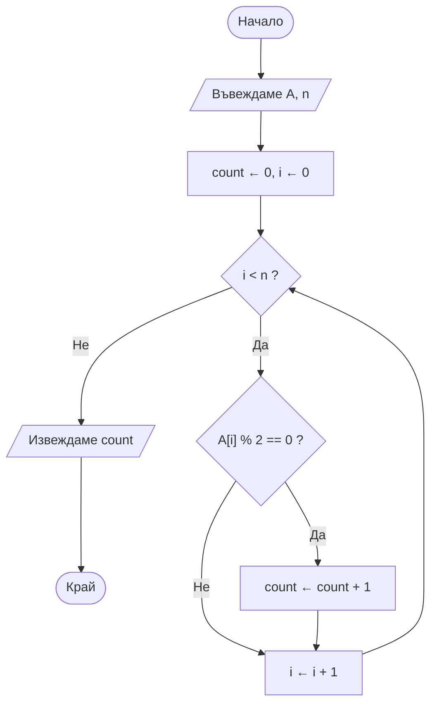
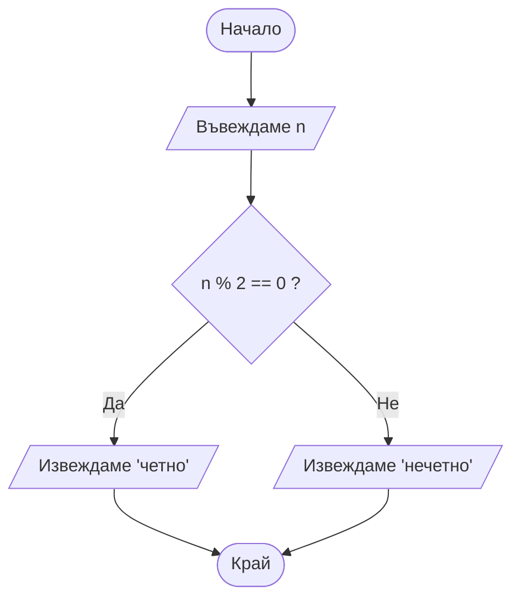

# Подготовка за контролно — Увод в Алгоритмите

**Теми:** Какво е алгоритъм, Псевдокод и блок-схеми, Анализ и оценка на алгоритми

---

## Структура на теста

- **Част I:** 10 затворени въпроса × 1 т. = 10 точки
- **Част II:** 5 отворени въпроса × 4 т. = 20 точки
- **Общо:** 30 точки

---

## 1. Какво е алгоритъм?

### Дефиниция

**Алгоритъм** е крайна, точно определена поредица от стъпки за решаване на даден проблем или клас проблеми. Приема **вход** и произвежда **изход**. Не зависи от езика за програмиране.

```
Проблем → Алгоритъм (план) → Програма (код) → Изпълнение
```

### Петте свойства

| Свойство | Английски | Значение |
|----------|-----------|----------|
| Краен брой стъпки | finiteness | Завършва след краен брой стъпки, не работи вечно |
| Точна определеност | definiteness | Всяка стъпка е недвусмислена, без място за тълкуване |
| Вход | input | **Нула** или повече стойности, подадени преди началото |
| Изход | output | **Една** или повече стойности, свързани с решението |
| Изпълнимост | effectiveness | Всяка стъпка е достатъчно проста, за да се изпълни точно за крайно време |

> Ако липсва дори едно свойство — това не е алгоритъм, а само неформална идея.

**Може ли алгоритъм да няма вход?** Да — входът е "нула или повече" (напр. алгоритъм, който отпечатва числата от 1 до 10).

**Може ли алгоритъм да няма изход?** Не — изходът е "една или повече" стойности. Алгоритъм без резултат не решава никакъв проблем.

### "Добро" срещу "лошо" описание

```
ЛОШО (не е алгоритъм):          ДОБРО (алгоритъм):
1. Вземи яйце                   Вход: яйце, тенджера, вода, котлон, таймер
2. Свари го както обикновено    1. Сложи яйцето в тенджерата
                                2. Налей вода, докато го покрие
                                3. Включи котлона на силен огън
                                4. Изчакай водата да заври
                                5. Намали огъня, таймер 7 минути
                                6. Изключи котлона
                                7. Сложи яйцето в студена вода за 1 минута
                                Изход: сварено яйце
```

"Както обикновено" / "някак си" / "малко" / "докато стане готово" → нарушават **точната определеност**.

Безкрайни инструкции ("повтаряй завинаги") → нарушават **крайния брой стъпки**.

### Алгоритъм срещу програма

| Алгоритъм | Програма |
|-----------|----------|
| Идея / план за решение | Конкретна имплементация |
| Независим от езика | Написана на конкретен език (C++, Python...) |
| Словесно, псевдокод, блок-схема | Синтаксис на езика |
| Един алгоритъм → **много** програми | Една програма → следва **един** алгоритъм |

Пример: Binary Search е **един** алгоритъм, но може да се напише на C++, Python, Java → различни програми.

### Как измисляме алгоритъм (5 стъпки)

1. Разбираме проблема — какъв е входът, какъв е изходът
2. Решаваме "на ръка" с малък пример
3. Обобщаваме в точни стъпки
4. Проверяваме **гранични случаи** — празен вход, един елемент, повтарящи се стойности, първа/последна позиция
5. Записваме формално — псевдокод или блок-схема

---

## 2. Псевдокод и блок-схеми

### Защо не пишем директно код?

- Обвързваме се със синтаксиса на езика твърде рано
- По-трудно обсъждаме идеята с хора, които не знаят езика
- По-лесно правим логически грешки, докато мислим и за синтаксис

```
Идея → Псевдокод / Блок-схема → Код на конкретен език
```

### Псевдокод — конвенции

Полу-формален, близък до естествен език, структуриран като код. **Няма строг синтаксис** — целта е яснота, не компилируемост.

| Конструкция | Запис |
|-------------|-------|
| Присвояване | `x ← 5` или `x = 5` |
| Условие | `if ... then ... else ...` |
| Цикли | `while ...`, `for each ...`, `for i from ... to ...` |
| Функция | `function име(параметри)` |
| Резултат | `return стойност` |
| Блокове | Отстъп (indentation) |
| Коментар | `// пояснение` |

### Пример — най-голям елемент

```
function findMax(numbers)
    max ← numbers[0]
    for i from 1 to n - 1:
        if numbers[i] > max then:
            max ← numbers[i]
    return max
```

### Пример — сбор от цифрите на число

```
function sumOfDigits(n)
    sum ← 0
    while n > 0:
        digit ← n % 10      // последната цифра
        sum ← sum + digit
        n ← n / 10          // целочислено деление — махаме последната цифра
    return sum
```

| n | `n % 10` | sum | `n / 10` |
|---|----------|-----|----------|
| 2749 | 9 | 9 | 274 |
| 274 | 4 | 13 | 27 |
| 27 | 7 | 20 | 2 |
| 2 | 2 | 22 | 0 → спираме |

### Символи на блок-схема

| Фигура | Значение | Mermaid | В код |
|--------|----------|---------|-------|
| **Овал** | Начало / Край | `([Начало])` | — |
| **Правоъгълник** | Действие / обработка | `[x ← x + 1]` | присвояване / оператор |
| **Паралелограм** | Вход / Изход | `[/Въвеждаме n/]` | `cin` / `cout` |
| **Ромб** | Условие (Да / Не) | `{i < n ?}` | `if` / `while` |

Стрелките показват **посоката на изпълнение**. **Цикъл** = стрелка, която се връща назад към условие.

### Пример — блок-схема на findMax



### Псевдокод срещу блок-схема

| Псевдокод | Блок-схема |
|-----------|------------|
| Текстов, бърз за писане | Визуален, по-бавен за рисуване |
| По-удобен за **сложни** алгоритми | По-удобна за **прости, кратки** алгоритми |
| По-близък до реалния код | По-лесна за обяснение на хора без опит |
| Предпочитан от програмисти | Предпочитана в документация, обучение |

И двата описват **един и същ** алгоритъм — изборът зависи от аудиторията и целта.

---

## 3. Анализ на алгоритми

### Защо не секунди?

Времето зависи от компютъра, натовареността, езика и компилатора. Искаме мярка, зависеща само от **алгоритъма** → броим **основни операции** (сравнения, присвоявания) спрямо размера на входа `n`.

### Времева и пространствена сложност

| Вид | Какво мери |
|-----|-----------|
| **Времева** | Как расте броят операции с нарастване на `n` |
| **Пространствена (паметна)** | Колко **допълнителна** памет се заделя спрямо `n` (входът не се брои!) |

### Big O

- Описва **горна граница** на растежа при голямо `n`
- Игнорираме **константите** и **по-малките членове** — пазим само доминиращия

```
3n² + 5n + 2   → O(n²)
2n + 2         → O(n)
7              → O(1)
n² - 3n        → O(n²)
5n + 20        → O(n)
n·log n + n    → O(n log n)
```

### Класове сложност (от най-бърз към най-бавен)

| Нотация | Име | Пример |
|---------|-----|--------|
| O(1) | Константна | Достъп до елемент на масив по индекс |
| O(log n) | Логаритмична | Binary Search |
| O(n) | Линейна | Линейно търсене, обхождане на масив |
| O(n log n) | Линейно-логаритмична | Merge Sort, Quick Sort (среден случай) |
| O(n²) | Квадратична | Bubble Sort, Selection Sort |
| O(2ⁿ) | Експоненциална | Наивна рекурсия за Fibonacci |
| O(n!) | Факториелна | Генериране на всички пермутации |

```
O(1) < O(log n) < O(n) < O(n log n) < O(n²) < O(2ⁿ) < O(n!)
```

### Как растат

```
             n = 10       n = 100         n = 1000
O(1)      →  1            1               1
O(log n)  →  ~3           ~7              ~10
O(n)      →  10           100             1000
O(n log n)→  ~33          ~664            ~9966
O(n²)     →  100          10 000          1 000 000
O(2ⁿ)     →  1024         огромно
```

**Удвои ли се n:** O(n) → удвоява се; O(n²) → **учетворява** се; O(log n) → +1 стъпка.

### Най-добър, среден и най-лош случай

| Случай | Значение | Линейно търсене |
|--------|----------|-----------------|
| Най-добър | Най-благоприятният вход | Елементът е **първи** → O(1) |
| Среден | Типичен вход | Някъде по средата (~n/2) → O(n) |
| Най-лош | Най-неблагоприятният вход | **Последен** или **липсва** → O(n) |

Обикновено гледаме **най-лошия случай** — той дава гаранция "никога няма да е по-бавно от това".

**Намиране на максимум:** и в трите случая O(n) — винаги обхождаме целия масив.

### Правила за извеждане на сложност от псевдокод

| Конструкция | Сложност |
|-------------|----------|
| Ред без цикъл | O(1) |
| Един цикъл от 0 до n | O(n) |
| Два вложени цикъла до n | O(n²) |
| Вложени цикли до n и до m | O(n · m) |
| Цикъл, който **дели** наполовина | O(log n) |
| Последователни блокове | **Събираме**, пазим най-големия: O(n) + O(n²) = O(n²) |

**Подход:** 1) броим колко пъти се изпълнява всеки ред → 2) събираме → 3) изхвърляме константите и по-малките членове.

```
sum = 0                  // 1
for i from 0 to n - 1:   // n
    sum = sum + A[i]     // n
return sum               // 1
// 2n + 2 → O(n)
```

```
i = n
while i > 1:     // ≈ log₂ n
    i = i / 2    // ≈ log₂ n
// n = 1024 → само 10 итерации → O(log n)
```

### Паметна сложност — какво заделя памет

| Източник | Памет |
|----------|-------|
| Фиксиран брой променливи (`sum`, `i`, `mid`) | O(1) |
| Нов масив с размер n | O(n) |
| Матрица n × n | O(n²) |
| Рекурсия | **дълбочина на рекурсията** × памет на едно извикване |

```
function factorial(n):
    if n <= 1 then: return 1
    return n * factorial(n - 1)
// Време: O(n), Памет: O(n) — n извиквания чакат в стека, въпреки че няма масив!
```

| Binary Search | Време | Памет |
|---------------|-------|-------|
| Итеративен | O(log n) | **O(1)** — само `low`, `high`, `mid` |
| Рекурсивен | O(log n) | **O(log n)** — стек с дълбочина log₂ n |

**Рекурсията не е безплатна** — харчи памет за стека.

### Компромис време / памет

- Можем да ускорим с **повече памет** (допълнителен масив, хеш таблица)
- Или да пестим памет с цената на **повече операции**
- Ограничена памет (вградени системи) → по-малко памет; огромни данни → по-малко време

### Други фактори за реалната скорост

Big O **скрива константите** → `2n` и `100n` са и двата O(n), но вторият е ~50 пъти по-бавен.

- **Кеш ефективност** — масивите са в последователна памет → съседните елементи вече са в кеша (locality of reference)
  - Обхождане на матрица **по редове** е по-бързо от **по колони**, въпреки че и двете са O(n²)
- **Структура от данни** — масив O(1) достъп по индекс, свързан списък O(n); списъкът е пръснат в паметта → лош кеш
- **Размер на входа** — при малко `n` "по-лош" алгоритъм може да е по-бърз (по-малки константи)
- **Вид на входа** — почти сортиран, с повторения, случаен
- **Рекурсия срещу цикъл** — всяко извикване има цена (стек, параметри)
- **Език, компилатор, хардуер, заделяне на памет**

Big O е **първи филтър** — при близки варианти се измерва на практика (профилиране).

### Линейно търсене срещу Binary Search

| Алгоритъм | Сортирани данни? | Най-лош случай | 1 000 000 елемента |
|-----------|------------------|----------------|--------------------|
| Линейно търсене | Не | O(n) | до 1 000 000 сравнения |
| Binary Search | **Да** | O(log n) | до ~20 сравнения |

---

## 4. Примерни задачи с решения

### Задача 1 — Сума на елементите в масив

```
function sumArray(A)
    sum ← 0
    for i from 0 to n - 1:
        sum ← sum + A[i]
    return sum
```

Време: **O(n)** · Памет: **O(1)** (само `sum` и `i`)

### Задача 2 — Броене на четни числа

```
function countEven(A)
    count ← 0
    for i from 0 to n - 1:
        if A[i] % 2 == 0 then:
            count ← count + 1
    return count
```



`[3, 8, 2, 7, 10, 5]` → **3** · Време: **O(n)** · Памет: **O(1)**

### Задача 3 — Четно или нечетно

```
function isEven(n)
    if n % 2 == 0 then:
        return true
    else:
        return false
```



Време: **O(1)** · Памет: **O(1)**

### Задача 4 — Линейно търсене

```
function linearSearch(A, target)
    for i from 0 to n - 1:
        if A[i] == target then:
            return i
    return -1
```

Най-добър: O(1) · Среден: O(n) · Най-лош: O(n) · Памет: O(1)

### Задача 5 — Проверка за просто число

```
function isPrime(n)
    if n < 2 then:
        return false
    for i from 2 to square_root(n):
        if n % i == 0 then:
            return false
    return true
```

Време: **O(√n)** (цикълът се върти до √n) · Памет: **O(1)**

### Задача 6 — Обърнато копие

```
function reverseCopy(A)
    B ← new array of size n
    for i from 0 to n - 1:
        B[i] ← A[n - 1 - i]
    return B
```

Време: **O(n)** · Памет: **O(n)** (нов масив B)

### Задача 7 — Последователни блокове

```
function mystery(A)
    total ← 0
    for i from 0 to n - 1:            // O(n)
        total ← total + A[i]
    for i from 0 to n - 1:            // O(n²)
        for j from 0 to n - 1:
            total ← total + A[i] * A[j]
    return total
```

O(n) + O(n²) = **O(n²)** · Памет: **O(1)**

### Задача 8 — Вложени цикли с различни граници

```
for i from 0 to n - 1:
    for j from 0 to m - 1:
        print i, j
```

Време: **O(n · m)** — не O(n²), защото границите са различни.

### Задача 9 — Два вложени цикъла, но O(n)

```
for i from 0 to n - 1:
    for j from 0 to 9:      // винаги 10 пъти, не зависи от n
        print A[i] + j
```

10 · n операции → **O(n)** — вътрешният цикъл е с константна граница.

---

## 5. Типични затворени въпроси по теми

### Какво е алгоритъм

- Петте свойства → **краен брой стъпки, точна определеност, вход, изход, изпълнимост**
- Вход → **нула** или повече; изход → **една** или повече
- "Свари го както обикновено" → нарушава **точната определеност**
- Един алгоритъм → **много** програми
- Алгоритъмът **не** зависи от езика за програмиране
- Проверка на гранични случаи → празен вход, един елемент, повторения

### Псевдокод и блок-схеми

- Псевдокод → **няма строг синтаксис**, целта е яснота
- Присвояване → `←` или `=`
- Овал → **начало/край**; правоъгълник → **действие**; паралелограм → **вход/изход**; ромб → **условие**
- Цикъл в блок-схема → стрелка, която се **връща назад** към условието
- Ромб в код → `if` / `while`; паралелограм → `cin` / `cout`
- Псевдокод → по-удобен за **сложни** алгоритми; блок-схема → за **прости**
- `2749 % 10` → **9**; `2749 / 10` (целочислено) → **274**

### Анализ на алгоритми

- Не мерим в секунди → зависи от **машината**
- Big O → **горна граница**, игнорираме константите
- `3n² + 5n + 2` → **O(n²)**
- Цикъл, който дели на 2 → **O(log n)**
- Последователни блокове → **събираме, пазим най-големия**
- Binary Search → **O(log n)**, изисква **сортирани** данни
- Линейно търсене, най-добър случай → **O(1)**
- Обикновено анализираме **най-лошия** случай
- Пространствена сложност → броим само **допълнителната** памет
- Рекурсивен factorial → памет **O(n)** (стек)
- Итеративен Binary Search → памет **O(1)**; рекурсивен → **O(log n)**
- Удвои ли се n при O(n²) → операциите се **учетворяват**
- Обхождане по редове е по-бързо → **кеш** (locality of reference)
- `2n` и `100n` → и двата **O(n)**, но реалното време се различава

---

## 6. Проследяване и пресмятане

### Брой операции → Big O

| Брой операции | Big O |
|---------------|-------|
| `7` | O(1) |
| `5n + 20` | O(n) |
| `2n² + 100n + 50` | O(n²) |
| `n² - 3n` | O(n²) |
| `n·log n + n` | O(n log n) |
| `2ⁿ + n³` | O(2ⁿ) |

### Брой итерации при деление наполовина

```
n = 16:  16 → 8 → 4 → 2 → 1   → 4 итерации  (log₂ 16 = 4)
n = 1024:                      → 10 итерации (log₂ 1024 = 10)
n = 1 000 000:                 → ~20 итерации
```

### Проследяване на findMax

```
A = [4, 9, 2, 11, 7]
max = 4
i=1: 9 > 4  → max = 9
i=2: 2 > 9  → не
i=3: 11 > 9 → max = 11
i=4: 7 > 11 → не
Изход: 11
```

### Проследяване на sumOfDigits

```
n = 508
508 % 10 = 8  → sum = 8,  n = 50
 50 % 10 = 0  → sum = 8,  n = 5
  5 % 10 = 5  → sum = 13, n = 0  → спираме
Изход: 13
```
